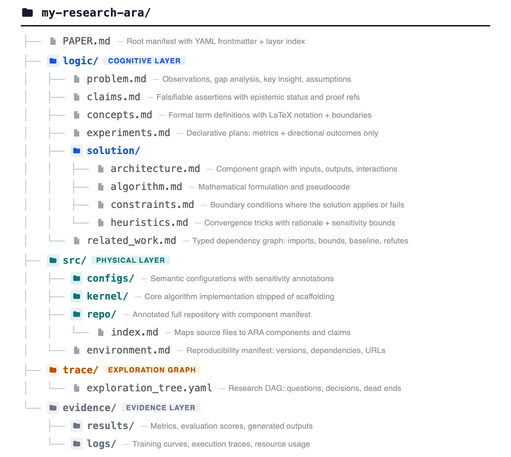

# 单源多格式迁移方案（PDF + 静态网页）

> 目标：让 `index.qmd` 从「只出 PDF」升级为「同一份源码同时出 PDF 和 HTML 静态网页」。
> 现状：PDF 已编译干净（50 页，0 错误 0 未定义引用）。本文件是网页端的架构方案 + 分步迁移清单。

---

## 1. 已验证的机制（POC 结论）

`_poc/poc.qmd` 用一份源码同时渲染出 PDF 和 HTML，全部通过：

| 机制 | PDF 结果 | HTML 结果 |
|---|---|---|
| Lua 短代码分支（``/``） | `\textsc{Ara}` / `\texttt{ara build}` | `<span class="ara">` / `<code>ara build</code>` |
| `content-visible when-format` 门控 | 只出 tcolorbox 面板 | 只出 `<div class="header-panel">` |
| `@key` 引用（citeproc） | 解析出完整文献条目 | 解析出完整文献条目 |
| 中文（ctex / 浏览器原生） | 渲染正常 | 渲染正常 |

**结论：单源多格式在这台机器上完全可行，无需改变已跑通的 PDF 编译路径。**

⚠️ 已知坑：xelatex 出的 PDF 里中文**能被渲染但 `pdftotext` 抽不出来**（字体缺 ToUnicode CMap）。影响网站全文检索/复制，不影响视觉。若网页需要中文可搜索，HTML 侧没问题（浏览器原生渲染），PDF 侧可后续换字体解决。

---

## 2. 目标架构

```
index.qmd (单源)
  ├── YAML 元数据：title / subtitle / authors / abstract / keywords
  │     └── PDF 面板继续用 raw LaTeX（bespoke tcolorbox 无法映射到 YAML author schema）
  ├── 正文：markdown（已基本完成）
  ├── 自定义命令 → Lua 短代码（跨格式分支，见 §3）
  ├── 图/表 → 二选一：原生 Quarto 语法 或 content-visible 门控（见 §4）
  ├── 引用 → @key（PDF 走 natbib+.bst，HTML 走 citeproc+CSL，见 §5）
  └── format:
        pdf:   (现有配置原样保留)
        html:  (新增：theme + CSS)
```

关键洞察：**PDF 侧几乎不用动**（它已经完美跑通），网页侧是「加一层并行渲染」，而不是重写。

---

## 3. 自定义命令 → 短代码（最高价值、零风险）

论文里的语义宏出现 ~140+ 次，全部是「内容不变、样式随格式变」，天然适合短代码。已写好 `_poc/ara.lua` 作种子，可扩展为完整版：

| 原命令 | 语义 | PDF 输出 | HTML 输出 |
|---|---|---|---|
| `\ara` | 智能体名 | `\textsc{Ara}` | `<span class="ara">Ara</span>` |
| `\cmd{x}` | 命令 | `\texttt{ara x}` | `<code>ara x</code>` |
| `\layer{x}` | 层级 | `\texttt{/x}` | `<code>/x</code>` |
| `\storytax` | 术语 | `\emph{Storytelling Tax}` | `<em>Storytelling Tax</em>` |
| `\engtax` | 术语 | `\emph{Engineering Tax}` | `<em>Engineering Tax</em>` |
| `\cmark`/`\xmark` | 对勾/叉 | `\textcolor{...}{\ding{51/55}}` | `✅`/`❌`（或 SVG） |
| `\todo{x}` | 待办 | `\textcolor{red}{[TODO: x]}` | `<mark>[TODO: x]</mark>` |

迁移步骤：把 `index.qmd` / `appendix.qmd` 里所有 `\ara` → ``、`\cmd{...}` → `` 等（机械替换 + 抽查），preamble 里的 `\newcommand` 保留（PDF 仍需），HTML 侧由短代码接管。

---

## 4. 图 / 表（15 图 + 14 表）——需要你拍板

三种策略，权衡不同：

**A. 原生 Quarto 语法（推荐，真正单源）**
```markdown
{#fig-directory}
```
- 图/表在 PDF 和 HTML 都自动渲染，交叉引用用 `@fig-directory` 统一。
- 代价：工作量最大，且 PDF 的双栏 `figure*`/`table*` 布局要重新调；HTML 是单栏，`figure*` 与 `figure` 在网页上收敛为同一布局。
- 适合：愿意接受 PDF 版图/表位置有细微变化（与现有「视觉接近」目标一致）。

**B. content-visible 门控（最快，双份维护）**
```markdown
::: {.content-visible when-format="pdf"}
```{=latex} ...原 raw 图块... ```
:::

::: {.content-visible when-format="html"}

:::
```
- PDF 侧零改动，HTML 侧另写一份 markdown 图。
- 代价：每张图两份，长期维护会漂移。

**C. 混合**：表用原生（markdown 管道表/原生 Quarto 表），图用门控（图的双栏布局差异大，表相对规整）。

我的建议：**先 C 再逐步 A**。表先原生化（管道表在两种格式都干净），图先门控保 PDF 原样，网页侧逐步换成原生图。

---

## 5. 引用 `\citep` → `@key`（机械但需仔细）

映射关系：
- `\citep{key}` → `[@key]`（括号式）
- `\citet{key}` → `@key`（正文式）
- `\citep{a,b}` → `[@a; @b]`
- `\citep[see][p.5]{key}` → `[see @key, p.5]`

格式配置：PDF 保持现有 `cite-method: natbib` + `biblio-style: styles/icml2026`（**`.bst` 原样保留，PDF 引文格式不变**）；HTML 用默认 citeproc + 一个 CSL。`@key` 语法在两条路径都被正确解析（POC 已验证）。

---

## 6. 标题面板（bespoke，双份）

`headerpanel` tcolorbox 无法映射到 Quarto 标准 author schema，所以：
- **PDF**：raw LaTeX 原样保留（现有代码不动），包进 `content-visible when-format="pdf"`。
- **HTML**：写一段等价的 HTML/CSS（浅蓝圆角卡片：标题、作者、单位、摘要、通讯/代码行），包进 `when-format="html"`。
- 作者/单位/摘要的**数据**抽到 YAML（title/subtitle/authors/abstract/keywords），两边各自引用，避免重复录入。

---

## 7. 构建与发布

`build.sh` 扩展为两条产物：

```bash
quarto render index.qmd --to pdf    # 或沿用现有手动 xelatex 管线
quarto render index.qmd --to html   # 产出 index.html + _site/
```

网页发布：
- **最简**：单篇 `index.html` 本身就是静态页，扔到任意静态托管即可。
- **进阶（若要多页站点）**：包一层 `_quarto.yml`（`project: type: website`）+ 落地页/关于页，参考 `quarto.org/docs/websites/website-blog.html` 的 listing 机制。

---

## 8. 决策清单（需要你拍板的点）

1. **图/表策略**：A（原生单源，工作量大）/ B（门控双份，最快）/ C（混合，建议）？
2. **网页形态**：单篇 `index.html`（最简）还是多页网站项目（落地页+文章）？
3. **PDF 中文可搜索性**：是否要花时间解决 pdftotext 抽不出中文的问题（换 CJK 字体 / 加 ToUnicode），还是先不管？
4. **CSS 主题**：HTML 用哪个 Bootswatch 主题 / 自写样式？

---

## 9. 落地顺序（建议）

1. 补全 `ara.lua` 短代码全集，机械替换正文里的自定义命令（零风险，PDF 不变）。
2. 加 `format: html` + 标题面板 HTML 版 + CSS，先让网页「能看」。
3. 引用 `\citep`→`@key` 全量替换，双格式验证引文。
4. 表原生化（C 策略），图先门控后逐步原生化。
5. 扩展 build.sh，双产物；决定发布形态。
